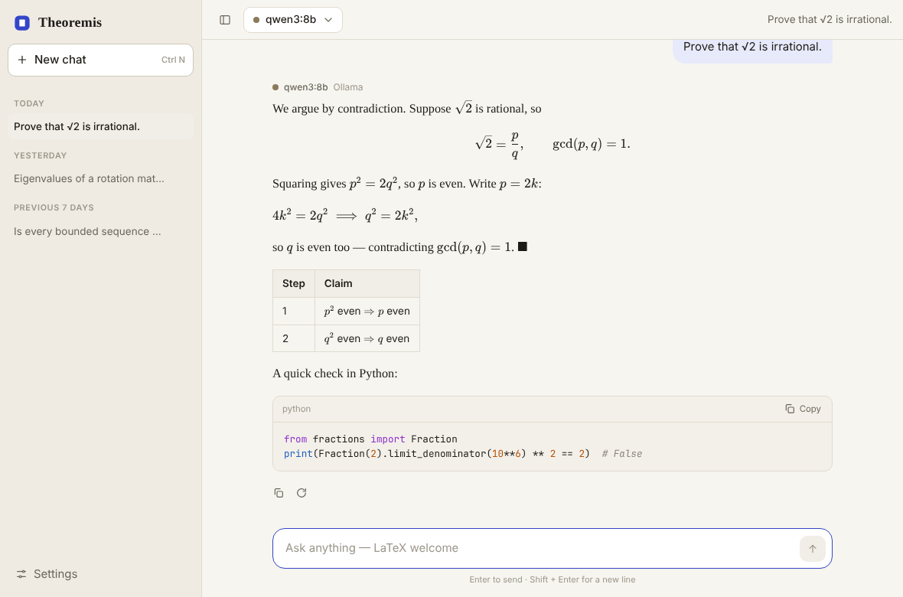
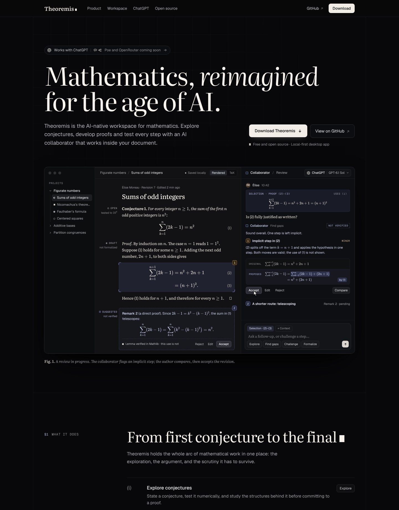

# Theoremis

### An AI-native workspace for mathematics, built around proofs you can actually check.

Explore conjectures, write mathematics, and collaborate with AI **inside your document**—then use **Lean 4 and Mathlib** to distinguish a convincing explanation from a machine-checked proof.

**Free, open-source desktop application · Public beta · macOS, Windows & Linux**

[**Download Theoremis →**](https://theoremis.com) · [Latest release](https://github.com/adamouks/theoremis/releases/latest) · [Explore the source](app/)



> [!NOTE]
> **Public beta:** ChatGPT, Ollama and Lean 4 checking are available, but the workflows are still evolving. Keep backups of important work and review AI suggestions before accepting them.

## Why Theoremis?

Mathematical work often happens across separate editors, chats, and proof assistants. Theoremis brings these activities into one workspace, without conflating AI-generated reasoning with mathematical verification.

- **Write mathematics naturally.** Markdown and LaTeX editing, numbered equations (including rows of `align`), and a toggle between rendered output and TeX source.
- **Keep track of what's established.** Statements can be *open, tested, draft, adopted, proved,* or *verified*. Status indicators in the gutter and sidebar show where a proof stands.
- **Reason alongside AI.** Highlight a step or work in one of four modes: **Explore**, **Find gaps**, **Challenge**, and **Formalize**. Feedback stays attached to its document context.
- **Manual or Auto.** In **Manual** the collaborator proposes and you decide. In **Auto** it does the work itself: it edits the document, writes Lean and checks it until Lean accepts, draws graphs, and reads the rest of the project. Every change is marked, listed step by step, and undone in one click. Only Lean can make a statement *verified*, even in Auto.
- **Check proofs with Lean 4.** Generate Lean code using Mathlib, run **Check with Lean**, inspect errors or dependencies on `sorry`, and mark a step verified only when the checker accepts it under the app's checks.
- **Bring in your research.** Import PDFs, photos of handwritten notes or a blackboard, LaTeX, Markdown, Word, HTML, Jupyter notebooks, CSV or code. A vision model transcribes them into statements with statuses, figures are copied straight from the PDF, and every paragraph links back to its page in the original.
- **Graph in 2D and 3D.** `graph` and `graph3d` blocks put a graphing calculator in the document: curves, implicit curves, regions, polar and parametric plots, sliders you can play, surfaces and curves in space. The collaborator can draw them too.
- **Show the collaborator anything.** Attach images, PDFs and files to a question, and paste screenshots straight into a paragraph.
- **Stay in control of edits.** Proposed rewrites show the original and replacement; accept, edit, reject, or undo. AI messages are explicitly labeled **not verified**.
- **Work locally.** Documents and threads are stored as files on your machine. Use a local Ollama model or connect a ChatGPT account.

## From an idea to a checked proof

1. **Write a conjecture** or a draft argument using Markdown and LaTeX, or import the paper or notes you already have.
2. **Select a step** and use **Find gaps** or **Challenge** to pressure-test the reasoning.
3. Choose **Formalize** to generate a candidate Lean 4 proof.
4. Run **Check with Lean** against Mathlib. If Lean reports errors or `sorry`, send the diagnostic back to the collaborator.
5. When the checker accepts an eligible proof, **mark the statement verified**. Until then, the AI's suggestions remain unverified.

This separates **exploration**, which AI can help accelerate, from **verification**, which requires more than a plausible-sounding response.

## Built as a desktop product

| Area | Implementation |
| --- | --- |
| Desktop and UI | [Tauri](https://tauri.app), Rust, React, TypeScript |
| AI collaboration | Sign in with ChatGPT (OAuth + PKCE), or connect to local [Ollama](https://ollama.com) models; Manual proposals or an Auto agent with document, Lean and graph tools |
| Formal checking | Lean 4, Mathlib, `lake env lean`, theorem/axiom inspection |
| Imports and graphs | pdf.js (text layer, rendering, figure detection), vision models, three.js, an expression language compiled without `eval` |
| Documents | Local JSON files, autosave, per-document conversation threads |
| Security-minded design | Encrypted sign-in credentials using an OS-keychain-backed key; AI edits require user approval |
| Distribution | macOS (Apple silicon and Intel), Windows and Linux installers; GitHub Actions CI and signed automatic updates |

### Engineering choices

**Native backend, web interface.** The Rust backend handles network calls, model streaming, authentication, storage, and Lean integration. React handles document editing and the collaborator. Tauri channels carry streamed replies into the interface.

**Authentication stays outside the webview.** The ChatGPT sign-in flow uses OAuth/PKCE and a loopback callback; tokens are encrypted at rest with a key from the system keychain. The application doesn't require an embedded API key.

**AI output is not a proof.** The Lean integration distinguishes accepted code, code that depends on `sorry`, and code that fails to compile. It reports unexpected axioms and screens out certain unsafe Lean constructs. These checks **are not a complete sandbox** for arbitrary code.

**A real release pipeline.** CI runs interface and backend checks. App changes trigger cross-platform release builds and signed update artifacts; installed copies can offer a restart when an update is ready.

For how the pieces fit together and why, see the [architecture guide](architecture.md). For implementation details, source layout, and local data paths, see the [developer guide](docs/DEVELOPMENT.md). For release automation and signing, see the [release guide](docs/RELEASING.md).

## Download and setup

**[Download the public beta at theoremis.com](https://theoremis.com)** or select an installer from [GitHub Releases](https://github.com/adamouks/theoremis/releases/latest).

On first launch, choose a blank document or the included *Figurate numbers* example project, then connect a model:

- **ChatGPT:** Open **Settings → ChatGPT → Sign in with ChatGPT**. The collaborator uses your connected ChatGPT account, subject to its usage limits. Prompts and relevant context are sent to the remote provider; local file storage does not mean this mode is offline.
- **Ollama:** Install [Ollama](https://ollama.com/download), pull a supported model, and choose it in Theoremis. With a locally configured Ollama server, inference can remain on your machine.
- **Lean 4 + Mathlib:** Go to **Settings → Lean 4 & Mathlib → Set up**. Setup installs or configures Lean and downloads a Mathlib project with prebuilt libraries. Allow roughly **5 GB** of disk space; Git is required.

> [!IMPORTANT]
> Current beta distributions have platform signing limitations. macOS may require **System Settings → Privacy & Security → Open Anyway** and Windows may display a SmartScreen prompt. See [release and signing details](docs/RELEASING.md).

### Develop locally

Prerequisites: Node.js 20+, stable Rust, and [Tauri system dependencies](https://tauri.app/start/prerequisites/).

```bash
git clone https://github.com/adamouks/theoremis.git
cd theoremis/app
npm install
npm run tauri dev
```

See [DEVELOPMENT.md](docs/DEVELOPMENT.md) for testing, architecture, Ollama and Lean setup, and website development.

## Project structure

```text
app/
  src/                 React + TypeScript UI
  src-tauri/src/       Rust backend (ChatGPT, Ollama, Lean, storage)
site/                  theoremis.com static site
docs/                  screenshots, developer and release documentation
architecture.md        how Theoremis works, and why it is built this way
.github/workflows/     CI and cross-platform releases
```



## Roadmap

- More model providers, including OpenRouter and Poe
- Update Mathlib from inside the app
- Document cross-references that renumber automatically
- Official macOS Developer ID and Windows release signing

These are planned capabilities, not promises of release dates.

## Open source

Theoremis is free and open source under the [MIT License](LICENSE). Contributions, bug reports, and feedback are welcome through [GitHub Issues](https://github.com/adamouks/theoremis/issues).

The collaborator's visual effects include code from [Libraries.dev](https://github.com/Jakubantalik/Libraries.dev) (MIT) and [React Bits](https://github.com/DavidHDev/react-bits) (MIT with the Commons Clause), with patterns from [Vercel AI Elements](https://github.com/vercel/ai-elements) (Apache-2.0) and [Prompt Kit](https://github.com/ibelick/prompt-kit) (MIT). Their notices are in [THIRD_PARTY_NOTICES.md](THIRD_PARTY_NOTICES.md).

**[Try Theoremis](https://theoremis.com) · [Download installers](https://github.com/adamouks/theoremis/releases/latest)**
